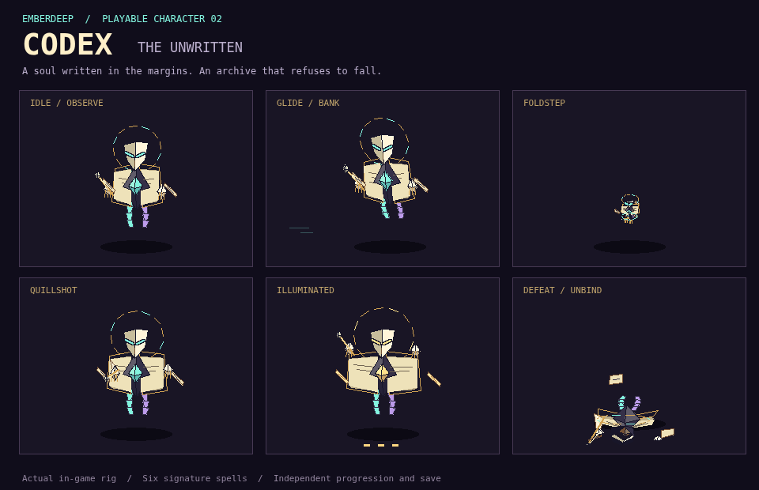

# my-3D2dge

**My "3D" 2D Game Engine.** A general-purpose, retro-modern 2D game engine built for AI models (LLMs). Everything is drawn by code, with no image or sound files, and the whole engine fits in one self-contained HTML file you can hand to any model.

**Play it live: [my-3d2dge.vercel.app](https://my-3d2dge.vercel.app)** (Emberdeep, the signature game). The other demos are [/arena](https://my-3d2dge.vercel.app/arena), [/stress-test](https://my-3d2dge.vercel.app/stress-test) and [/perspective-lab](https://my-3d2dge.vercel.app/perspective-lab), and the starter kits are at /kits/&lt;adventure|animlab|brawler|platformer|puzzle|roguelike|rpg|shooter|stealth&gt;; the 3D kits, a real 3D world under the game, are at [/kits/3d-action](https://my-3d2dge.vercel.app/kits/3d-action), [/kits/3d-platformer](https://my-3d2dge.vercel.app/kits/3d-platformer), [/kits/3d-shooter](https://my-3d2dge.vercel.app/kits/3d-shooter) (an open world, first or third person) and [/kits/3d-horror](https://my-3d2dge.vercel.app/kits/3d-horror) (survival horror under fixed cameras), all in [/3d](https://my-3d2dge.vercel.app/3d). The engine for a script tag is [/dist/my-3d2dge.min.js](https://my-3d2dge.vercel.app/dist/my-3d2dge.min.js), and the one-file edition for AI coding agents is [/dist/my-3d2dge-agent.js](https://my-3d2dge.vercel.app/dist/my-3d2dge-agent.js). Every merge to `main` redeploys the site (see `vercel.json`).

## North star

my-3D2dge exists so that any AI model, including older and smaller ones, can **port, remaster, reimagine and remix games from the 8-bit to 64-bit eras** (NES, SNES, Genesis, N64, PS1), and **build spiritual successors** that play like modern remasters. That means modernized visuals, physics and controls, plus a sandbox for mashing up mechanics across titles and genres.

To get there, the engine ships enough perspectives, genre frameworks, vertical-slice modes, features and gameplay mechanics that the quality stays **consistent**, no matter which model is driving.

## How it works

- **The world is 3D; the camera is a classic 2D view.** Game logic lives in world units (x east, y south, z up; one tile = 16). A view projects the world as isometric, three-quarter, top-down, brawler, side-on or a custom angle, and the same game runs in every one of them.
- **Characters are procedural puppets.** Humanoid and blob rigs are 3D skeletons posed by math every step (IK legs and arms, gait, jumps, attacks, capes) and drawn as crisp pixel art. Small things (coins, ships, bullets, icons) can be pixel sprites written as strings.
- **Genre kits that snap together.** Top-down levels (`TileMap` + `Body`), side-scroller levels (`PlatformMap` + `Platformer`), bullets and patterns, dialog boxes, menus, scenes, chip-tune audio, save data. Any kit works with any other, so a shooter can have RPG dialog and a platformer can have Zelda rooms.

## Share it with an AI model

| File | For | Size |
|---|---|---|
| **`dist/handoff/`** ([on the site](https://my-3d2dge.vercel.app/handoff/); `node tools/handoff.mjs --zip <file>` for a chat) | **Coding agents that need the full engine** (props, lighting, x-ray, sessions: what the agent edition leaves out). The readable engine and the agent edition, `API.md`, `API-INDEX.md` (every public name), `AI_GUIDE.md`, the tools that check, film and replay a game, and a template game with a headless test. Its `README.md` says where to start. | text only, ~1.3 MB; read `API.md`, search the rest |
| **`dist/my-3d2dge-agent.js`** | **AI coding agents** (Claude Code, Codex, Cursor and the like). The [agent edition](#the-agent-edition-for-ai-coding-agents): the essential engine in one readable file whose header is the whole manual, with three complete example games. An agent reads the header and nothing else. | header ~10k tokens, whole file ~105k |
| **`dist/kits/my-3d2dge-<genre>.html`** | The usual choice for chat models. Minified engine, the API card and the one slice for your genre (`adventure`, `pointclick`, `platformer`, `metroidvania`, `brawler`, `fighting`, `shooter`, `arcade`, `pinball`, `kart`, `road`, `puzzle`, `rhythm`, `rpg`, `roguelike`, `tactics`, `rts`, `artillery`, `sim`, `stealth`), or `animlab` to explore the animation system. Each was sized for a 200k context (D51; D52 suspends that budget until the owner's review, and thirteen kits are past it): its engine leaves out the sections its game never calls (the kit diet: its header lists them; a game of several genres takes `dist/my-3d2dge.html`), and each carries a small cut of the asset store of its own (`src/assets/sets/<genre>.js`, 600 to 1,400 tokens). | ~181k-243k tokens (the RPG's journey is the largest) |
| **`dist/kits/my-3d2dge-3d-<genre>.html`** | A [3D kit](#real-3d-the-3d-engine): the same, with the 3D engine and its manual and one 3D slice (`action`, `platformer`, `shooter`, `horror`, `racing`, `flight`). Served, not opened from a disk: it loads three.js and Rapier from `vendor/`. | ~240k-315k tokens (the shooter's open world is the largest) |
| **`dist/my-3d2dge-compact.html`** | Every slice and the animation lab, engine minified (every section and module): for a game of several genres. | ~681k tokens (past the plan's 500,000 line: kept whole until the owner's review, D55) |
| **`dist/my-3d2dge.html`** | The complete reference: readable engine, every slice and the animation lab. For 1M-token contexts, or for a model that reads the file in parts. | ~845k tokens |

Token counts are cl100k, measured at v0.78.0 (`gpt-tokenizer`); other tokenizers differ.

Attach a file and ask for a game ("remake Mega Man 2's first stage", "a Zelda-like with three dungeons", "a spiritual successor to Gradius"). Each file contains:

1. **The API card**: a quick-start game, a table of coordinates per view, rules, common mistakes, the full API and a genre playbook.
2. **The engine** (no dependencies, no network).
3. **A starter game** with twenty-one vertical slices to copy from (a genre kit holds one):
   - ADVENTURE (Zelda-style top-down)
   - POINT-AND-CLICK (Monkey Island / Broken Sword: a harbour, a tavern and a lighthouse, four puzzles, a riddle contest to win, the nine verbs or a verb coin, an inventory, walk areas with holes and depth: the click and story modules)
   - PLATFORMER (Mario / Mega Man side-scroller with a 2.5D view)
   - METROIDVANIA (Super Metroid: twelve rooms joined at their doors, the map of what was seen, a second jump and a dash that open the gates, an arm cannon aimed eight ways, a save room, a mini-boss and a boss: the rooms module)
   - BRAWLER (Final Fight / Streets of Rage beat-'em-up; a second player drops in)
   - FIGHTING (Street Fighter II one on one: three fighters, versus for two, an arcade ladder against the CPU, training: the fight module)
   - SHOOTER (a 1942-style vertical stage, then a Gradius-style horizontal one: rock above and below, a power bar, options; a continue, initials and a table)
   - ARCADE (a cabinet of three: a maze with four chasers, a formation of diving moths, wrapping rocks; tables, initials, two players and an attract mode: the arcade module)
   - PINBALL (Pinball Fantasies / Space Cadet: one table seen down its slant, flippers, bumpers, slingshots, a ramp over the table, drop targets, a spinner, a kickback, a jackpot and a multiball, nudging and tilt, a dot-matrix display, high scores and an attract mode: the physics and arcade modules)
   - KART (Super Mario Kart in Mode 7: six karts with HD drivers, three laps, drifts that charge a boost, item boxes, VS for two in a split screen: the mode7 and drive modules)
   - ROAD (OutRun: a coast road against the clock, curves and hills, a tunnel, traffic, checkpoints, a radio of three songs: the road module)
   - RPG (Dragon Quest / Final Fantasy: a town to talk your way through, a world map of 256 x 256 cells, a cave and its boss, random encounters swirling into the ATB battle, levels, gear, menus and save slots: the story and rpg modules)
   - ROGUELIKE (Rogue / Mystery Dungeon: ten generated floors, fields of view and fog, turns by speed, the grid and gen modules)
   - TACTICS (Final Fantasy Tactics / Fire Emblem: an isometric hill fort of heights, four heroes against five, charge time or phases, jump heights, blows from behind, bows' arcs, areas, a scoring AI, the cell under the cursor in any turn of the view: the grid and story modules)
   - RTS (Warcraft II / StarCraft: workers mining gold, a hall, a barracks and a stable to build, footmen, archers and knights, fog, a minimap, an enemy camp across a river that builds and attacks in waves: the grid and strategy modules)
   - ARTILLERY (Worms / Scorched Earth: two teams of three on an island every blast carves, turns, aim and power, wind, a rocket, a bouncing grenade and a cluster bomb, falls and the sea, a CPU that tries its shots in simulation, two players in turn: the physics, terrain and grid modules)
   - SIM (Theme Park / RollerCoaster Tycoon: lay paths, build four rides that turn and two stands, guests with money and needs who queue, ride, eat and leave happy or not, prices, a rating, day and night, 1x to 4x: the grid and strategy modules)
   - RHYTHM (Dance Dance Revolution / PaRappa: STEP UP!, two songs on four lanes, notes, jumps and holds, a rapping teacher to answer, judged on the music clock, a combo, a life gauge and a grade, a dancer and a crowd on the beat, the audio offset's calibration: the songs and rhythm modules)
   - PUZZLE (Tetris by today's rules and Puyo Puyo's chaining pairs, with a mascot; versus for two)
   - STEALTH (Assassin's Creed / Metal Gear third-person: roofs to climb and leap, guards that see and search, takedowns)
   - ANIMATION LAB: every move, pose and reaction on every skin, in every view, with zoom, rotation, slow motion and frame stepping

The model copies the closest slice and replaces the code between `GAME START` and `GAME END`. Opened in a browser, the same file is playable, full screen at any shape: a desktop or ultrawide monitor, a tablet, a phone either way up, with no black bars (`res: 'ps1', expand: true`: 320x240 is the least it shows). Each slice fills the extra space with its own world, edge to edge, the HUD over the corners, and its prompts name the player's own keys. On a phone the first tap goes full screen, the menu button sits at the top right, every menu has a close button and swipes back, the back gesture pauses instead of leaving, and the controls are smart: the adventure's TALK button shows only beside someone (and its camera slides room by room, as Zelda's, or scrolls: Settings, or C), the RPG takes taps on its windows, commands and foes, and the shooter's ship follows your thumb and fires by itself. Press `?` for the API card, and add `#adventure`, `#platformer`, `#brawler`, `#shooter`, `#puzzle`, `#rpg` (`#rpg/battle` for the battle alone), `#roguelike`, `#stealth` or `#animlab` to the address to jump straight into a slice.

### The agent edition (for AI coding agents)

`dist/my-3d2dge-agent.js` is the engine cut down to what an agent needs to build games, in one readable file. Its header is the whole manual: how to host a game, the mental model, a complete game (title, play, win or lose), the API for every kit, a side-scroller and a shoot-'em-up recipe, and the rules. A coding agent reads those ~9k tokens and builds from them; the code below is there to debug, sectioned by `// ---- N. NAME` banners so it can be grepped.

- **Kept:** the game loop and scenes, keyboard, mouse and gamepad input, every view, the depth-sorted renderer, pixel primitives, string sprites, the 5x7 font and title text, UI windows, dialog and menus, particles and hit effects, the chip synth with every sound effect and song, `TileMap` + `Body` + `FlowField` (with `fill` and `setFloor`), `E.sees`, `E.hears`, `r.marker`, `PlatformMap` + `Platformer`, `Bullets` and patterns, the HD `Humanoid` with every pose and move (plus capes, outfits and hats), and `Blob` monsters.
- **Left to the full engine:** canvas and WebGPU lighting, props, parallax backdrops, touch controls, camera zoom and turn, dialog portraits, x-ray silhouettes and afterimages, the classic and skeleton rigs, weapon trails, NES-style dithering, the 3x5 font, and the extra wall, roof and tile materials. Calling one of these in the agent edition does nothing (it warns once), so full-engine code degrades instead of crashing. The third-person kit (`Mover`, `E.ACTIONS`, `E.Suspicion`, sight cones, facades, footprints) is the full engine's too: `r.sightCone` does nothing here, and `new E.Mover()`, `E.Action` and `E.Suspicion` throw an error that says so. So is `E.Shell`, the HTML interface: here it does nothing (it warns once).
- **Compatible upward:** its API is a strict subset of the full engine's, so a game written for it runs unchanged on `dist/my-3d2dge.js`. `npm run test:agent` checks this. It plays every example in the header on both engines, drives a coverage scene through every rig option, pose, move, view and kit, and compares the two APIs name by name.

The file is 105k tokens in all (265k for the readable full engine, 182k-198k for a genre kit). The header ends with a map of what lies outside the file and how to take from it: the store of motion clips (search the catalogs, cut the clips a game needs into a small set, play them on any Humanoid), Emberdeep's worked examples and the genre kits. `API.md`, `AI_GUIDE.md` and the full engine's header carry the same map, and `npm run test:agent` checks that every path it names exists and that its recipe works. Its source is `engine/my-3d2dge-agent.js`, a curated copy of the engine, so fixes to the full engine are ported to it by hand. `node tools/build.mjs` copies it to `dist/`.

### Real 3D: the 3D engine

`engine/my-3d2dge-3d.js` (`dist/my-3d2dge-3d.js`) puts a real 3D world under a game, built from the stress test's 3D
world: three.js r182 draws it and Rapier 0.19.3 simulates it, both vendored in `vendor/`. The 2D engine still runs the
game (`new E.Game({ ..., bg: null })`: its canvas is clear, the HUD and menus draw over the 3D picture), so a 3D game
keeps the pause menu, settings, touch buttons, boot screen and sound. `new E.World3D(game, { level })` gives a level
written as text (walls, raised floors, stairs, platforms in the air, pits, pillars, braziers), heroes walked by Rapier's
character controller and mobs that are physics bodies, the 2D engine's rigs as cards or 3D puppets, pickups and set
dressing drawn by code, moving platforms, a camera with the 2D views in real 3D plus chase, first person and fly, fixed
cameras by room (camera zones, cut with hysteresis), lock-on, tank controls, doors between rooms, vehicles on tracks
(karts, cars and hovercraft with arcade handling, banked roads with walls and boost pads, raced by the drive module's
`E.Race`), flight (free within bounds or on rails, barrel rolls, lock-on), split screen, torches, a sun, a sky, a
flashlight, the game's particles in 3D, and filters (Comic cel, Pixel). The same inputs give the same `world.hash()` on
WebGPU and WebGL 2. Its header is the whole manual (about 6,800 tokens, with a complete game). The 3D starter
(`dist/my-3d2dge-3d.html`, [/3d](https://my-3d2dge.vercel.app/3d)) has six slices, each a 3D kit: ACTION (a torch-lit hall,
a combo, a dash, a jump, a bolt and lock-on against five waves and a knight), PLATFORMER (a course of islands over the
void: double jumps, moving platforms, springs, coins and three stars), SHOOTER (a badlands two kilometres across, in
first or third person: sprint, slide, vault, climb, ziplines, a rifle and a shotgun against outposts), HORROR (a
mansion's wings by flashlight under fixed cameras: a pistol that locks on, zombies and dogs, keys, a crank, herbs, an
item box and a typewriter's saves, a boss), RACING (a kart circuit in a valley: banked bends, a jump, a dirt
shortcut, drifts that charge a boost, items, five drivers, two players split) and FLIGHT (on rails over the sea to a
base, then a flagship in free flight: lasers, charged lock-on shots, barrel rolls, a wingman on the radio). See
`docs/ENGINE-3D.md`.

## Try it

| File | What it shows |
|---|---|
| `dist/my-3d2dge-3d.html` | The 3D starter (served: `npx serve`, then `/dist/my-3d2dge-3d.html`): a title stage in 3D and the six 3D slices. `C` changes the camera (the view, chase, first person), `V` the view, `[` / `]` turn it, the wheel zooms, `Q` locks on; the pause menu's Display picks cards or puppets, the picture's resolution, shadows and a filter. Deep links: `#action`, `#platformer`, `#shooter`, `#horror`, `#racing` (`#racing/vs`), `#flight`. |
| `dist/my-3d2dge.html` | Title menu plus the six vertical slices and the animation lab. Arrows and Enter; `V` changes the view, `-` / `=` or the mouse wheel zoom, `[` / `]` turn the camera where a scene allows it, `0` resets it, `M` mutes. |
| **`examples/emberdeep.html`** | **Emberdeep**, the engine's signature game: a hack-and-slash that goes down forever (see below). Deep links: `#town`, `#depth-7`, `#proving`, `#gallery`, or one gallery entry such as `#gallery/bestiary/husk`, `#gallery/skills/whirlwind`, `#gallery/poses/fall` or `#gallery/moves/climb-up`. |
| `examples/arena.html` | **Emberwell**, an action-RPG arena with WebGPU lighting, its stores heaped in the corners as the engine's core shapes. One game in four views: isometric (Diablo, Bastion), three-quarter (Zelda, Stardew Valley), top-down and brawler. Keys `1`-`4` or `V` switch, or open `arena.html#threequarter`. |
| `examples/perspective-lab.html` | One room in every view, with lighting and skeleton toggles |
| `examples/mocap-lab.html` | Ready-made animation from 3D libraries, stored as readable key poses an AI model can read and edit, in four sets (**G** switches): all 88 free clips of [Quaternius' Universal Animation Library 1 and 2](https://quaternius.com/packs/universalanimationlibrary.html), the 177 human clips of [Mesh2Motion](https://github.com/Mesh2Motion/mesh2motion-app) (all CC0), 60 moments cut from the [CMU motion capture database](http://mocap.cs.cmu.edu/) (free for all uses): gaits, fighting moves, falls and get-ups, townsfolk chores, gestures, monsters acted by people and acrobatics. and every one of its 2,548 takes, loaded as you pick it, in the **CMU library** (`?set=library`). `tools/cmu.mjs` downloads all of them, converts and measures every one, and keeps the ledger of them all (`src/mocap/catalogs/cmu-takes.tsv`: category, length, fit, which clips use it, which to import next); the importer cuts and loops the picked moments, and the 15 the Emberdeep hero adopted. Every clip records where it came from: its library, the clip it was made from, or the take and seconds it was cut from. Each plays on a pixel-art look-alike of the libraries' mannequin and, retargeted, on the engine's hero, in every view, in slow motion, frame by frame and with a bone overlay. The hero turns, rolls and goes upside down with the clip (his face follows its head), and **X** puts his sword away (`?sword=0`); **O** sets a table, a stool, a crate and a barrel beside the stage for scale (`?props`); in side view a clip that travels stands the two figures one ahead of the other. The AI panel shows the clip as editable text (Apply plays your edit), the catalog a model picks from, and the set's size and accuracy. Deep links: `#Dance_Loop`, `?set=mesh2motion`, `?set=cmu`, `?view=side`. See `docs/MOCAP.md`. |
| `examples/asset-lab.html` | **The Asset Lab**: every object, material and sprite a game can use without drawing code, searchable. The engine's core library (25 shapes, 61 materials) and the asset store's sets, converted from CC0 libraries: Kenney's and KayKit's low-poly kits as shapes of named parts, ambientCG's PBR sets as fitted materials, Kenney's Tiny pixel packs as exact sprites, each with where it came from and how closely it fits. Each entry is drawn as games draw it, in every view and turning beside the hero on a choice of floors; pick one to see the engine draw it in a room, turn it, edit its text and **Apply**, or **Copy** it. Deep links: `#barrel`, `?set=kenney-furniture`, `?kind=sprites`, `?view=threequarter`. See `docs/ASSETS.md` and `docs/ASSET-IMPORT.md`. |
| `examples/stress-test.html` | Up to 5,000 monsters in stick, HD, skeleton or knight rigs that attack with telegraphed moves and fall when beaten; 30 shadow-casting torches, up to 400 of the engine's core shapes, particle storms, camera distance, zoom and turn, a benchmark and a copyable report |
| `examples/scarfrunner-side.html` | The standalone side-scrolling prototype that came before the engine |
| **`examples/labs.html`** | **Labs**: every page above, one tap away, at [my-3d2dge.vercel.app/labs](https://my-3d2dge.vercel.app/labs) (also the **All labs** button in Emberdeep's Settings, under Tools and Keys & help, and the **All labs** link on each lab). A bar at the top jumps to each section. A card opens its page from anywhere on it, and its chips are other places to start (the CMU clips, the Proving Grounds, a view). Built from the list in `src/labs.json`, in its order: **The road to Emberdeep** (Scarfrunner, Emberwell, the Perspective Lab, the stress test and Emberdeep, numbered in the order they were made), **Starter kits** (a tile for each kit) and **Tools** are kept; **Temporary** holds the prototypes in the order they were made: one-off comparisons, each led by the question it answers, with its date, the page it led to and any way it departs from the doctrine, deleted or graduated once settled. It is empty now: the last three (the 3D Proof, the 3D Prototype and Vesper's interface) were answered and deleted in v0.51.4 (D44). `tools/labs-test.mjs` opens every link. Held upright on a phone, every lab's picture fills the screen. |

Each branch also gets a Vercel preview at its own address (for example `my-3d2dge-git-<branch>-…vercel.app`); its Labs page says **preview of work not merged yet**, so work can be tried on a phone before it is merged. To keep what Vercel stores (and bills) small, a preview leaves out the CMU library and loads the live site's copy (`tools/stamp.mjs`), and a push that changes only `src/` or `tools/` (which the deploy leaves out) deploys nothing (`vercel.json`'s `ignoreCommand`).

## Emberdeep, the signature game

[Play it in the browser](https://my-3d2dge.vercel.app). `examples/emberdeep.html` is a Diablo IV / Path of Exile II style hack-and-slash built on the engine, and it's the showcase for everything above. It grew out of the stress test: the same swordsman (teal tunic, red cape), the same rune hall and the same crowds.

- **Fluid, fast combat.** A slash > backslash > spin combo, a forward dodge roll (a new animation layered on the rig), lunges out of the roll, perfect dodges that slow time, and a potion drunk with an IK-driven arm while you keep fighting. Hit-stop, shake and sparks on every blow, and slow-motion finishers.
- **Skills and a passive tree.** 18 active skills with five ranks and two runes each, on six slots (LMB, RMB, 1-4):
  - melee: cleaves, a whirlwind, lunges, leap slams, launchers that juggle, kicks that bowl bodies into packs, a brawler's flurry, and a thrown sword that returns to his hand;
  - spells: frost nova, chain lightning, meteor, void rift, orbiting spectral blades, a war cry that sends monsters fleeing, a shadow step, and an Echo, a ghostly double of the hero that fights beside him.
  A 199-star passive constellation adds notables and build-defining keystones (Blood Magic, Glass Cannon, Juggernaut...). Past it, seeded rings of deep stars keep waking, and past rank 5 a skill point buys mastery and deeper rune tiers, so every point always buys something.
- **Monsters and bosses.**
  - Husks, skeletons, bone throwers, cultists who raise the dead from the floor, brutes, duelists that sidestep, monks who guard, shield bulwarks you must flank, roosting bats, imps, bloaters, and slimes that split.
  - New procedural rigs: IK-legged crawlers, a burrowing serpent that surfaces in arcs, and a floating Watcher with a sweeping beam.
  - Ten elite affixes.
  - Bosses: the Cinder King on his throne, the Brood Mother, the Deep Wyrm, then composed bosses built from a body, an element and a pattern library.
- **Wardens, executions and takedowns** (the engine's perception and actions). From depth 3, hooded Wardens walk a beat with a lantern on a staff. Each sees down its lantern's cone (cut short by walls, and drawn on the floor exactly as it sees), grows suspicious ('?'), searches where it saw you, and once sure ('!') rings its bell: the alarm wakes every monster that hears it, a wall halving it. Strike it before it rings, or take it down from behind with E while it hasn't seen you. A humanoid you stagger near the end of its life reels, and E leaps onto it for an execution: two bodies, one action, a dodge and some life back. Knocked flat, the hero sits up, comes to one knee and stands.
- **Loot.** Common to legendary and unique items with rolled affixes, roll-quality pips and ranges, and legendary powers. Deep legendaries compose new powers from a vocabulary of triggers and effects, and affix tiers keep coming forever. Gear visibly changes the hero: colors, helms, armor, capes, blades and their elemental trails. A stash chest holds 160 items, and salvage gives crafting materials for the smith and the mystic.
- **Emberhold.** The last lit town, with animated townsfolk: the smith hammers, the mystic floats, the merchant sweeps, the guard patrols, the priestess prays. There are shops, crafting, a stash and the waystone down, and the small stories of a town: a garden in rows round its scarecrow, graves by the memorial stones, a woodpile, a laden produce cart.
- **Scenes in every room.** On top of each theme's own dressing, the dungeons lay out small stories from the asset store: a robbed tomb, a smith's corner, a camp the cold took, the miners' table, a wake, an explorers' camp whose fire lights the room.
- **One new element per depth.** Each planned depth brings exactly one new mechanic and is named after it: powder kegs (The Powder Vaults), rune wards, chasms, gale vents, magma (The Molten Throne), ice, brood nests, storm pylons, time wells, webs (The Webbed Lair), darkness, blood rush, launch runes, floods, tremors (The Shuddering Descent). A boss waits every fifth depth. You can ignore each element and hack through; speedrunners and power-levelers exploit it.
- **It never ends.** Past the planned depths every level is composed from the same parts:
  - themes recolored by depth;
  - mechanics mixed two at a time, then three (from depth 31) and four (from depth 101), named after the mix ("The Shuddering, Webbed Caverns"), with a card that explains how they combine;
  - packs with elements, shared affixes, giants and swarms;
  - bosses built from a boss body, an element and a set of close, zone and aid patterns;
  - item levels that keep scaling.
- **Captured moments.** The hero plays motion-captured and hand-animated clips (Quaternius and Mesh2Motion, CC0) where code animation had no answer. He lands on one knee and a hand when he drops into a depth, and gets up off the ground when revived. He nods and listens when someone talks, folds his arms while a shopkeeper serves him, lifts the stash's lid and works the waystone. He reaches for loot while walking and snaps back from a heavy blow. He pumps a fist at a new level and jumps for joy when a boss falls. He dies three ways: a stagger and fall, a slow sink when poison or fire wears him down, and thrown off his feet by a crushing blow. Each is retargeted to his build, so his cape and hair follow (`docs/MOCAP.md`).
- **A gallery.** `#gallery` plays every skill on straw training dummies, every monster's moveset, every boss's entrance, the hero's full pose vocabulary and captured moments, and the engine's moves (the execution and the takedown, getting up, climbing up and down a block, hopping down, vaulting, a roll), in any view and in slow motion.
- **Challenging.** Bosses usually take a real fight and sometimes a second try, and a level-up heals only part of your life. **For playtesting**, Settings → Difficulty has sliders for hero damage, life and speed (movement, attacks and casting), the same for monsters, plus density, experience and loot. `__ed.botRun({ to: 10 })` lets an autopilot play depth after depth, and the title screen runs it as a demo when left idle.

**Controls:** WASD or the arrows to move, the mouse to aim; LMB, RMB and 1-4 fire the six skill slots; Space or Shift dodges; Q drinks a potion, E talks or picks up (and executes a reeling foe, or takes a Warden down from behind), T opens a portal home; I the bag, K the skills, P the passive tree, Tab the map, Z the loot labels, Esc pauses; V changes the view, - and = zoom, [ and ] turn the camera, 0 resets it, M mutes, H hides the HUD. **Settings → Controls** (from the title or the pause menu) rebinds keyboard, mouse, and controller buttons. Bindings and controller/touch preferences save automatically; conflicts are reported and defaults can be restored. Menu navigation remains available even after movement is rebound.

- **Gamepad:** left stick moves, right stick aims; X/Y/B/LB/RB/RT fire the six slots, A dodges, LT drinks a potion, L3 interacts, R3 opens a portal, View opens inventory, Menu pauses. D-pad or left stick navigates menus, A selects, and Menu goes back. The pause menu also opens Skills and Passives. Controls includes deadzone, vibration, aim assist, inverted aim, and a live controller monitor. The controller rumbles with every screen shake and every blow the hero takes.
- **Touch:** drag the movement side of the screen while pressing an action button with another finger. The overlay provides all six skills, dodge, potion, interaction, map, inventory, portal, and menu. Adjust handedness, size, opacity, and automatic/always/hidden display in Controls. Menus respond to taps; the gallery has Previous/Next, Reel, Replay, and Slow buttons.
- **Phones:** the game fills the screen either way you hold it. Held upright (9:16), the HUD bar sits just above the action buttons, the minimap under the menu buttons, and the hero in the open ground between them; on its side the action buttons stand above the ember orb. The HUD keeps clear of the notch, the status bar and the home bar. A tap on the title menu goes full screen (Android and other browsers that allow it); **FULL SCREEN** on the title and in the pause menu turns it on and off, and leaving it is remembered. An iPhone has no full screen for web pages: use Share, then **Add to Home Screen**, and Emberdeep opens as an app with no browser bars.
- **Settings:** one window for everything the game can change, from the title or the pause menu (Esc), with a search box that finds any setting. **Game:** Graphics (the view, the camera's zoom and turn, pixel size, frame rate, full screen, GPU or full lighting and the darkness, outlines, particles, screen shake, the automatic quality, a frame-rate overlay and collision circles), Sound, Interface (damage numbers, health bars, loot labels, the HUD, the tips) and Controls. **Playtest:** Difficulty, and Tools: invulnerability, unlimited resources, no cooldowns, frozen AI, simulation pause, frame stepping and speed, autopilot, travel to depths 1–500 and the town, Proving Grounds and Gallery, monster and boss spawning, map reveal, items, skill unlocks, points and gold, and recording a session. The whole game is a test bench: the tools act on the hero you play, and he saves as usual (the switches last until a reload, and the screen names the ones in force). **Tuning:** every rule number, a page per part of the game (`src/emberdeep/TUNING.md`). **Help:** every key as bound now, and where to change what.

The game pauses on focus loss, clears cancelled touch/held inputs, and remembers the selected camera view.

**A second playable character: Codex, the Unwritten.** Choose **CHARACTER → Codex → PLAY AS CODEX** on the title screen, or [start as Codex](https://my-3d2dge.vercel.app/?character=codex). A separate save keeps your Wanderer intact. Codex is a living archive with a porcelain mask, hinged folio body, detached hands, a writing quill, orbiting leaves and trailing bookmarks. A custom procedural rig glides and banks, folds into a sigil to dodge, writes spells, drinks, reacts, falls apart and reforms; inventory, echoes, gallery and every camera view use that identity.

Codex starts with six signature spells. **Quillshot** charges three manuscript pages; the next signature spell becomes **Illuminated**. **Margin Seal** traps a pack, **Razor Folio** throws returning pages, **Revision** restores life and a dodge, **Living Index** orbits cutting leaves, and **The Last Word** draws foes into an exploding book. Upgrade ranks and runes, mix in shared skills, equip loot, craft, and spend passive points as usual. The hover is visual: terrain and hazards still apply.



[Watch the animated rig](docs/assets/codex-motion.gif) · [Character design and verification](docs/CODEX.md)

**A third: Dan, the Brood-Scythe.** [Start as Dan](https://my-3d2dge.vercel.app/?character=dan). A stalking beast adapted from concept art: two bone scythes for forearms, a horned crown, reverse-kneed legs, a tail, and egg sacs on its hips that ripen with every kill. It reaps in three-cut combos, pounces and impales, whirls, roars into a frenzy, and spends its brood as broodlings that hunt or as a void blast that grows with every sac. See [docs/DAN.md](docs/DAN.md).

**More characters.** Playable characters are a registry like monsters and skills: each one is a file that registers with `def('characters', id, spec)`, and nothing shared changes. `npm run new:character -- <id>` writes a hero that already works (a dressed Humanoid, or a custom body), `npm run character:check -- <id>` tests it and draws its character sheet (every state in every view, with numbers for size, contrast and motion), and `docs/CHARACTERS.md` is the recipe.

The source is `src/emberdeep/*.js`, joined into one script. `src/emberdeep/DESIGN.md` explains the modular "language" (registries for elements, skills, monsters, affixes, bosses, patterns, items, powers, mechanics, themes and layouts). `tools/ed-play.mjs` (scripted headless playtests) and `tools/ed-smoke.mjs` (every scene and depth) test it.

## What's in the engine

`engine/my-3d2dge.js` has no dependencies.

**Views and rendering**
- Five preset views plus custom views (yaw, pitch, scale).
- Fixed console resolutions: `res: 'nes' | 'snes' | 'genesis' | 'gb' | 'gba' | 'ps1' | [w, h]`.
- Pixel-snapped primitives with world-anchored dithering.
- Depth-sorted rendering with outlines, rim light, hit flash, afterimages and x-ray silhouettes.
- Dithered skies and parallax starfields.

**The look kit (v0.6: aimed at PS1 / N64 era 2D, not NES)**
- HD characters: volumetric, shaded limbs, a shaped torso, hands and boots.
  - Faces: eyes with catch-lights, brows, mouth, ears.
  - Side views get a cheated 3/4 turn so bodies read in profile, and swords chop in the screen plane.
  - Steep top-down views draw characters from a lower, sprite-like angle so faces show, like SNES RPG sprites.
  - Weapon trails follow the real blade, fist or foot path in every view.
  - Builds: `chibi`, `heroic`, `bulky`, `skeleton`.
  - Poses: cheer, cast, guard, kneel, and knocked down.
  - Outfits: tunic, robe, coat. Plus armor, sleeves and hats.
  - Hair: short, spiky, long, ponytail. Long hair and ponytails flow like cloth.
  - `size` for 40-60 px heroes.
- Hue-shifted shading everywhere (`E.tones`, `E.ramp`): shadows lean cool, highlights warm.
- `E.Backdrop`: parallax scenery with atmospheric haze.
  - Layers: mountains, hills, forest, city, castle, clouds, sea, fog, stalactites; sun or moon, stars.
  - Presets: `day`, `dusk`, `night`, `castle-night`, `city-night`, `desert`, `forest`, `ocean`, `cave`, `space`.
- Textured tiles: stone with moss, bricks, wood, riveted metal, grass-topped ground, with carved edges. Floors get contact shadows and water/lava shimmer.
- Wall materials for top-down, iso and brawler maps: brick, stone, rock cliff, planks, Tudor timber, plaster and hedge, with tiled roofs, paving, leafy or grassy tops.
- 38 procedural props (`r.prop`):
  - lights with animated, glowing flames: torches, candles, chandeliers, lanterns, street lamps, fire drums;
  - stained-glass windows, banners, pillars (whole or broken), statues;
  - chests and doors (shut or open), crates, barrels, sandbags;
  - trees, palms, cactus, mushrooms, vines, cobwebs;
  - awnings, hydrants, trash cans and more.
- Character close-ups: `talk.say(lines, { portrait: rig })` puts a live face beside every dialog line; `rig.drawPortrait` draws one on HUDs and menus. Radio chatter (`auto`, `modal: false`) keeps talking while you play.
- Effects: `particles.explosion` (fireball, smoke, sparks, debris, shockwave, shake, sound), fire, smoke, glints, and screen `flash`. Smoke and fire are hard-edged puffs in flat tones, not soft blurs. `game.hitFx` adds hit-stop, an impact star, sparks, a bouncing damage number and a sound in one call, and hit flashes keep the sprite's shading.
- Typography: a 5x7 proportional pixel font with lower case, drop shadows and gradients, plus `E.font.title` for extruded gradient logos.

**Characters and animation**
- `Humanoid`, with:
  - weapons: sword, gun, staff
  - capes, jump pose, aiming up and down, ladder climbing
  - squash and stretch, and skeleton debug view
  - `style: 'classic'` stick figures for huge crowds
- A move library, `E.MOVES`:
  - blades and clubs: slash, backslash, overhead, rising, thrust, spin, plunge, two-handed;
  - fists: jab, cross, hook, uppercut, haymaker, elbow;
  - kicks: front kick, roundhouse, sweep, flying kick, knee, axe kick;
  - other: cast, throw, bash, claw.
- Every move has anticipation, a committed strike (lunge, step, lean, torso twist), follow-through and a clean return to the stance. The same move fits every build and view, and horizontal swings become screen-plane chops in side views. `E.Combo(['jab', 'cross', 'hook', 'uppercut'])` chains them.
- Stances (`guard`, `ready`) and poses: cheer, cast, guard, kneel, crouch, wave, hands on hips, knocked down. Idle rigs breathe and shift their weight.
- `Blob` for slimes and round monsters, with optional ears, horns, bat wings, feet, a tail and fangs.
- Pixel sprites from strings.

**Levels and physics**
- `TileMap` for top-down, isometric and brawler levels:
  - ASCII levels with spawn tags and floor tags, extruded walls and camera cutaway
  - floor tags that block walking (deep water, lava), which pathfinding avoids
  - height-aware collision, so bodies can jump onto blocks
  - flow-field pathfinding over heights (fields that climb, drop and leap gaps between roofs), and procedural floor
    textures (stone, grass, dirt, water, planks, checker)
  - maps built in code (`fill`, `setFloor`); facades from wall-type options (windows, doors, shutters, balconies,
    arches) or your own `decorate(face)` painter; and footprints, so a big thing sorts over every block under it
- `PlatformMap` for side-scrollers:
  - tile kinds: solid, one-way, ladder, hazard, background and decoration
  - tile styles: ground, brick, block, bonus, pipe, spikes, liquid
  - drawn flat in the side view and as 2.5D in tilted views
- `Platformer` controller:
  - coyote time, jump buffering and variable jump height
  - ladders, dropping through one-way platforms, riding moving platforms
  - optional double jump, wall jump and dash
- `Body` for top-down physics: friction, bounce, knockback, and jumping onto blocks.
- `Mover`, the ground controller for third-person games: walking, running, sprinting and sneaking with acceleration, a
  jump with coyote time and buffering, climbing onto ledges, vaulting low walls, leaping gaps (it aims for the far
  side), hopping down, landing rolls and fall damage, and a last safe spot to respawn at. It takes `game.input` or an
  AI's intent.
- `E.ACTIONS`: timed actions that move a body along a curve and pose its rig (climb up and down, vault, hop down, roll,
  get up, and a paired takedown that drives two bodies). Add your own the same way.
- Perception for stealth: `E.sees` (sight through the height rules; cover, tall grass and crouching lower a target's
  exposure), `E.hears`, and `E.Suspicion`, a guard's mind from calm to notice, search and alert. `r.sightCone` draws
  what a guard sees, cut short by walls, and `r.marker` an objective marker that becomes an arrow at the screen's edge.
- `Bullets` with patterns (aim, spread, ring), and a `SpatialHash` for crowds.

**Game structure**
- Scenes (title, play, game over) with per-scene view, keys and resolution.
- Pause, timers (`after`, `every`), hit-stop, screen shake and slow motion.
- A camera with bounds and room-by-room movement, plus zoom and rotation (`game.setZoom`, `game.rotateView`): the world re-rasterizes crisply at any size while the HUD stays put. A scene can let the player zoom it too, within its range (`camera: { zoom: [.75, 2], start: 1 }`): the mouse wheel, a pinch on a phone or a setting, kept on top of the zoom the scene starts at.
- Save data (`E.store`).

**Standard features, in every game with no code** (`docs/STANDARD-FEATURES.md`)
- A pause menu on pausable scenes: Resume, Settings, Controls, Full screen and Quit to title (it asks first), driven by keys, mouse, gamepad or touch.
- Settings saved per game, with a version, every value checked on load (`game.settings`): sound, volume, music, effects, reduce motion, screen shake and flashes, pixel scaling, and the game's own (difficulty, hints).
- Controls the player rebinds by pressing the new key or button, conflicts said before anything changes, the menus' keys kept so nobody locks themselves out; the controller's dead zone, invert aim, button symbols (Xbox, PlayStation, Nintendo) and vibration; the touch buttons' side, size and opacity. `input.label(action)` gives prompts the right key or button.
- Full screen (`game.fullscreen`): a phone's first tap, a corner button and the menu; leaving it is remembered. Pausing when the page is hidden or the controller is unplugged. A page set up for phones (safe areas, no scrolling or zooming on the game).
- A boot: heavy setup runs one step a frame behind a boot screen (the system's checks, a progress bar, the game's own lines), then a warm-up frame; a failure before play shows a report a player can screenshot (`E.diagnose()`). The built pages show it from their first paint.
- Adjusted with `new E.Game({ menu: { items, settings, controls, quit } })`, or left out (`menu: false`, `fullscreen: false`, `corner: false`, `autoPause: false`).

**Input**
- Keyboard, mouse, gamepad and touch (a floating stick with a dead zone, plus on-screen buttons the player can move, size and hide).
- Presets for action, platformer, shooter and third-person games.
- `pressed`, `repeat` and buffered presses.
- Two to four players on one machine (`game.players`): each joins with Start on a free gamepad, or two share the keyboard a half each; prompts, the pause, a lost controller and the Controls screen are per player. One screen framed to everyone (`cam.frame`), or a split screen of two to four viewports (`game.splitScreen`).

**Text and UI**
- A 5x7 proportional pixel font (plus the old 3x5 as `font: 'tiny'`) with scale, alignment, word wrap, shadows and gradients.
- Window boxes, bars and hearts.
- Typewriter `Dialog` boxes with names and choices, and `Menu` with a cursor.
- `E.Shell`, an HTML interface for modern adaptations, built from data: title, pause, settings, controls, help, results and map
  screens, and HUD pieces (objective with its distance, status, bars, prompt with hold progress, toasts, a tutorial
  card, a minimap). Keyboard, gamepad and touch move its focus; it honors reduced motion and the safe-area insets;
  CSS variables theme it.

**Sound**
- A chip synthesizer with no audio files: square, pulse, triangle, saw, sine and noise.
- About 30 preset sound effects and a step sequencer.
- Five built-in original songs: title, adventure, dungeon, boss and victory.

**Lighting and translucency**
- Colored lighting that works everywhere, no WebGPU needed:
  - dark areas take a smooth cool tint and each light adds its own color;
  - flames, sparks, bullets and anything marked `emissive` stay bright.
- Real translucency in 1/8 steps with add, multiply and screen blending, like PS1 and SNES hardware. Shadows, glows, fog, skies, fades and flashes use it. `E.style.trans = 'dither'` switches to NES, Game Boy or Genesis-style dithering.
- Optional WebGPU lighting: soft shadows cast by walls, light wrap, glow, bloom and heat shimmer. It falls back to the Canvas lighting automatically.

**Built for models**
- Clear errors in an on-screen box, with one-time warnings for common mistakes (unknown view, action, sound, legend character or wall type, or a bad color).
- Forgiving inputs: `'#rgb'` colors, canvas lookup by id, string presets.
- Recorded sessions: `E.session.record(true)` records play on any device (frame times, inputs, the random seed, the screen, the save), and `node tools/replay.mjs session.json` replays it headless, exactly, so a bug seen on a phone happens again where an agent can look at it. In Emberdeep: Settings → Tools → Record a session.

## Genre coverage

| Era genre | View | Kit |
|---|---|---|
| Platformers, Metroidvanias, run-and-guns (Mario, Mega Man, Metroid, Contra) | side, or brawler for 2.5D | PlatformMap, Platformer (crouching, ledges, clinging, water, ropes, bars, swinging, momentum), Bullets; the rooms module: a world of rooms, the map, gates, saves (METROIDVANIA kit) |
| Action adventures and action RPGs (Zelda, Secret of Mana, Diablo, Landstalker) | three-quarter, top-down, iso | TileMap, Body, Humanoid, Dialog |
| Point-and-click adventures and visual novels (Monkey Island, Day of the Tentacle, Broken Sword, Phoenix Wright) | rooms painted in screen pixels | the click module: walk areas with holes (the shortest way round), depth scale, hotspots, SCUMM's nine verbs, Sierra's icons, a verb coin, an inventory, puzzles as rules; the story module's talk, backlog, auto and skip (POINT-AND-CLICK kit) |
| Beat-'em-ups and fighting (Final Fight, Streets of Rage, Street Fighter II) | brawler, side | Humanoid attack and kick specs (BRAWLER kit); the fight module: frame data, guards, throws, specials by motion, rounds, a CPU, training (FIGHTING kit) |
| Shoot-'em-ups (1942, Xevious, Gradius, R-Type) | overhead | Bullets, patterns, a vertical and a horizontal stage, the arcade frame (SHOOTER kit) |
| Rail shooters and flight (Star Fox 64, Panzer Dragoon; light guns with the pointer) | the 3D engine's behind camera | `world.flyer` on rails (a window across a path) or free within bounds, barrel rolls that turn shots aside, `f.seek` for a charged shot's lock, a terrain, `Dialog`'s radio (3D FLIGHT kit) |
| JRPGs (Dragon Quest, Final Fantasy, EarthBound) | three-quarter towns and world maps, brawler battles | the story and rpg modules (dialogue as data, quests, items, gear, levels, shops, encounters), Dialog markup, save slots, chunked big maps (the RPG kit) |
| Puzzle (Tetris, Puyo Puyo, Columns) | screen pixels over a stage | a cell array, `input.repeat`, the grid module's groups (PUZZLE kit) |
| Roguelikes (Rogue, Mystery Dungeon, Shiren) | three-quarter, iso | the gen and grid modules: floors, paths, fields of view, fog, turns (ROGUELIKE kit) |
| Tactics (Final Fantasy Tactics, Tactics Ogre, Shining Force, Fire Emblem) | iso, turned in quarters | `map.pick` (the cell under the cursor on a map of heights), the grid module's reach over heights, shapes of effect, facing, threat maps, `E.Turns` by charge time or phases (TACTICS kit) |
| Real-time strategy and sims (Dune II, Warcraft II, StarCraft, SimCity, Theme Park) | iso, top-down, three-quarter | the strategy module: selection by click, box and group, orders and formations on shared flow fields, production, resources, placement, fog, the minimap, an enemy's build order and waves; a free camera and `r.pick` in the core; the day clock, needs, overlays (RTS and SIM kits) |
| Arcade (Pac-Man, Galaga, Asteroids, Breakout) | overhead | the arcade module (tables, initials, turns, attract mode), GridMover mazes, Path dives, wrap-around (ARCADE kit) |
| Physics toys (Pinball Fantasies, Space Cadet, Worms, Scorched Earth, Breakout, Lemmings) | a steep table view, side at a whole scale, overhead | the physics module: rigid bodies, fast balls that never pass through, flippers, bumpers, kickers, layers; the terrain module: ground carved by blasts, walkers on slopes, a collider for grenades; touch zones (PINBALL and ARTILLERY kits) |
| Rhythm and music (Dance Dance Revolution, PaRappa the Rapper, Beatmania, Space Channel 5) | any | the music clock (a song's place is game time, the sound held to it), layers, stingers, crossfades, the audio offset; the songs module's songbook; the rhythm module: charts, judgments in ms, holds, call and response, a highway in any direction (RHYTHM kit; the STEALTH slice's chase by layers) |
| Racing (Super Mario Kart, F-Zero, OutRun, Pole Position, Micro Machines, Mario Kart 64) | Mode 7, the pseudo-3D road, top-down | the mode7, road and drive modules: a floor a row at a time, the road's segments, cars with grip and drift, races with laps and drivers (KART and ROAD kits); in real 3D, `world.vehicle` and `world.track` (banked roads, walls, pads, a shortcut) raced by `E.Race`, split screen (3D RACING kit) |
| 3D-era remakes (Mario 64, Ocarina, Crash) | iso, three-quarter, brawler | TileMap blocks with heights plus Body jumping (z is real height); in real 3D, the 3D engine: a level as text, a character controller, the chase camera, lock-on (`camera.lock`) (3D ACTION and 3D PLATFORMER kits) |
| Survival horror (Resident Evil, Alone in the Dark, Silent Hill) | the 3D engine's fixed cameras | camera zones (fixed, turning, on a rail; cuts that keep the stick's way), tank or modern controls (`camera.steer`), lock-on aiming high and low, doors between rooms (`world.through`), locked doors and keys, a flashlight that flickers, fog; the rpg module's six-slot inventory, an item box, saves at a typewriter (3D HORROR kit) |
| Third-person action and stealth, adapted (Assassin's Creed, Metal Gear, Tenchu) | iso, three-quarter | TileMap roofs, Mover, E.ACTIONS, E.sees + E.Suspicion, FlowField with jumps |

What the era's genres still need, from the early 80s to the late PS1, and the milestones that add it with a kit for each family: `docs/HANDOFF-GENRES.md`.

## Build and check

The source of truth is `engine/my-3d2dge.js` plus the game scripts and templates in `src/`. To regenerate `examples/` and `dist/`, run:

```
npm install                  # once: Playwright (checker) and terser (compact build)
node tools/build.mjs
```

This writes:
- the `examples/`;
- `dist/my-3d2dge.html` and `dist/my-3d2dge-compact.html`;
- the genre kits in `dist/kits/`, each on the kit diet (its engine without the sections its game never calls: `DIET` in `tools/build.mjs`, `tools/diet.mjs`), and the 3D starter `dist/my-3d2dge-3d.html` with a 3D kit per slice;
- the engine alone as `dist/my-3d2dge.js` and `dist/my-3d2dge.min.js`, for multi-file projects;
- the agent edition as `dist/my-3d2dge-agent.js` (copied from `engine/my-3d2dge-agent.js`);
- the 3D engine as `dist/my-3d2dge-3d.js` (copied from `engine/my-3d2dge-3d.js`).

To test any game file in a headless browser, run the checker:

```
npx playwright install chromium   # once
node tools/check.mjs dist/my-3d2dge.html#platformer
npm test                         # rebuild, syntax, controls + developer browser regressions
npm run test:smoke -- --secs 2    # title, town, gallery, proving, depths 1–20
npm run test:smoke -- --character codex --secs 2 --out check-output/codex-smoke
npm run test:codex                # character, spells, progression, saves and device checks
npm run test:agent                # agent edition: header examples and a coverage scene on both engines, API subset
npm run test:mocap                # both animation sets on the mannequin and the hero in every view, and the hero's captured moments in Emberdeep
npm run doctrine:check            # the doctrine's quick checks: binary files, the manuals' token budgets, the API boundary, the decisions log
npm run test:determinism          # a fight in Emberdeep and in a starter game, played twice under the harness: the same pixels
npm run test:replay               # sessions recorded in real time (desk, phone touch, a starter) replay to the same state
npm run test:kit3d                # the 3D engine and kits: their rules, the manual's quick start, every 3D kit on WebGL 2 and WebGPU (the same proof hash), a phone
npm run test:phone                # the starter kits on an emulated phone, upright and on its side (about a minute): first tap, steering, reach, frame time, thumb-sized buttons
npm run test:kits                 # every kit: its title, its slice's proof twice (the same hash), nothing the kit diet left out called; the reference editions' title menu
npm run test:kits -- --compare <dir>   # also film every 2D kit beside the same kit in <dir> (another build): the same pixels, or it fails
npm run test:motion               # game.go's transitions and the weather, filmed (check-output/motion/); the screen filter on the canvas only
npm run test:modules              # the path every engine module takes, proven with a fixture module in a copy of the repository
npm run test:views                # the mode7 and road modules' views, filmed twice (the same pixels), and a frame of each within a phone's budget
node tools/replay.mjs session.json --shots 600   # replay a recorded session (a bug report) headless, with pictures
npm run bench -- --brief assassins-creed --dry-run   # the North Star's measures: a fresh agent, a brief, the handoff package (a real run spends money: ask first)
npm run character:check -- codex   # one playable character: the character test and its character sheet (check-output/sheet-codex.png)
node tools/ed-balance.mjs --character codex --to 5   # the autopilot plays a hero against the Wanderer, depth by depth
```

Every browser tool accepts `CHROMIUM_PATH` to use an already installed Chromium instead of Playwright's download. In Claude Code cloud sessions, `.claude/hooks/session-start.sh` runs `npm install` and sets it for you.

To check an animation frame by frame, record a contact sheet:

```
node tools/filmstrip.mjs dist/my-3d2dge.html#brawler --steps "wait:1500 press:Enter wait:800 rec:16:2 press:KeyJ" --crop 20,60,150,140
```

`--seed 1` makes the strip repeatable: time is virtual and randomness seeded, so the same command gives the same frames, pixel for pixel. `--compare other.html` records the same steps from a second build and marks every pixel that differs, to check that a change did only what it should:

```
node tools/filmstrip.mjs "examples/emberdeep.html?view=threequarter#gallery/bestiary/husk" --seed 1 --steps "wait:200 rec:16:36" --compare before.html
```

The checker presses start and plays the game (move, jump, attack, fire), then cycles the game's views. It reports errors, engine warnings, frame times, how much of each screenshot is filled, and look notes that flag cheap-looking frames (a thin palette, large flat areas, checkerboard dithering, low contrast). It fails (exit code 1) on any error, or when gameplay leaves the screen blank.

## Versions

One version number covers the engine, its agent edition, the docs and the games: `My3D2dge.version`, now **0.81.0**. Every change merged to `main` bumps it, except one confined to a prototype (a Temporary lab, `DOCTRINE.md`) (`node tools/version.mjs 0.8.0` writes it everywhere) and adds its lines to `CHANGELOG.md`; `npm test` fails while any place disagrees. The deployed site stamps each page with the commit it was built from (`tools/stamp.mjs`, run by Vercel), so the Emberdeep title, its Settings (Keys & help), the Labs page and the Mocap Lab say exactly which build they are (`v0.7.0 · a1b2c3d 2026-10-07`).

## Docs

- `DOCTRINE.md`: what the engine optimizes (good ideas found per unit of time and tokens) and its ten principles for an engine built for AI coding agents, then how each applies here, what was grandfathered when it was adopted, and which check holds it. `docs/DECISIONS.md` logs every deviation, exception and call made without an answer, and is never cleaned up.
- `docs/FEEDBACK-LOG.md`: the points from builders' feedback that we did not act on, counted by theme so patterns show. What we act on goes into a plan (`docs/HANDOFF-*.md`), then the changelog.
- `API.md`: the API card, under its budget of 21,000 tokens (D50, D54, D58, D59). It is embedded in every single-file edition.
- `engine/modules/README.md`: engine modules, general systems in files of their own that load after the core (a kit carries the ones its slice names): how one is written, its manual and its budget, and how it is tested.
- The header of `dist/my-3d2dge-agent.js`: the agent edition's manual, about 9,000 tokens, with three complete example games.
- `API-INDEX.md`: every public name in the engine, one line each (signature, units, defaults, what it does), with the height rules at the top. Written by `tools/api-index.mjs` from the engine; search it.
- `AI_GUIDE.md`: the full guide for models and people. It covers frame order, every system, genre recipes, the remake workflow and a pre-handoff checklist.
- `docs/ENGINE-3D.md`: the 3D engine (`engine/my-3d2dge-3d.js`) and the 3D kits: how they sit on the 2D engine, what they hold, how they are checked, and what three.js and Rapier taught.
- `docs/CHARACTERS.md`: adding a playable character to Emberdeep, from a brief to a checked hero: the scaffold, the body contract, the character test, the character sheet and the balance run.
- `CHANGELOG.md`: what each version changed, by part (rendering, animation, art, mocap, Emberdeep, characters, tools, docs). `CLAUDE.md`: the rules every change follows (versioning, building, testing).
- `docs/ASSETS.md`: the asset card: still objects and materials as data (`r.shape`, `E.MATERIALS`), the core library, writing an object and checking it with `tools/asset-sheet.mjs`. `docs/ASSET-IMPORT.md`: how the asset store is made from CC0 libraries (`tools/asset-fetch.mjs`, `asset-import.mjs`, `asset-set.mjs`, `asset-find.mjs`), adding a library step by step, provenance and fit.
- `docs/MOCAP.md`: importing ready-made skeletal animation into the readable key-pose format: a step-by-step guide to adding a library (`tools/to-glb.py` converts Blender, FBX and BVH files, `tools/anim-import.mjs` imports, `tools/anim-sheet.mjs` draws contact sheets for the catalog, `tools/anim-set.mjs` picks a game's clips), where to get more animation and what it costs, retargeting onto the engine's rigs, and the hero's captured moments.

## License

MIT
